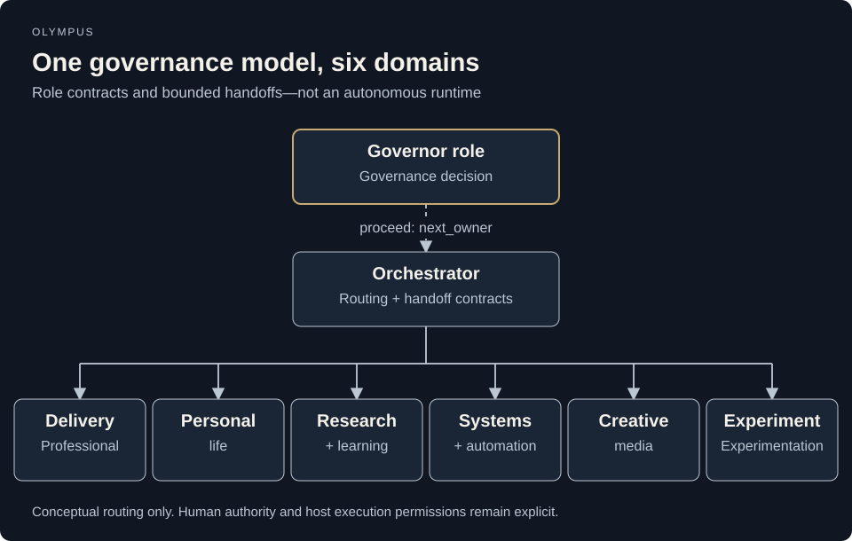

# Olympus

**Explicit ownership for governed AI teams.**

Olympus defines a theme-independent operating model for AI collaboration: governance admits work, orchestration coordinates it, and accountable Domain Owners produce bounded results.

> **Status: architectural foundation, not a production agent runtime.** This repository contains declarative role contracts, documented boundaries, and historical host-side validation evidence. Cloning it does not start agents or provision services. External contributions are currently paused.

## Why it exists

An assistant should not silently become the owner, reviewer, memory store, and approval authority for every task. Olympus makes those responsibilities explicit:

- **Governor:** decides whether an initiative can proceed, must stop, or needs clarification.
- **Orchestrator:** establishes ownership, dependencies, readiness, and the bounded handoff.
- **Domain Owner:** remains accountable for one outcome domain and returns evidence-backed work.
- **Human approval:** remains separate from producing, reviewing, and releasing an artifact.

## Architecture



This is a role-contract tree, not a claim that this repository runs six autonomous services. The SVG is the editable source.


This is a responsibility model, not proof of runtime dispatch. Greek names are replaceable aliases; canonical roles and Domain identifiers define authority.

## Available contracts

| Domain | Canonical Owner |
| --- | --- |
| `professional_delivery` | `professional_delivery_owner` |
| `research_learning` | `research_learning_owner` |
| `personal_life` | `personal_life_owner` |
| `systems_automation` | `systems_automation_owner` |
| `experimentation` | `experimentation_owner` |
| `creative_media` | `creative_media_owner` |

Availability means a declarative definition, not a persistent instance. Foundation Contract v0.1 is the architectural baseline. Durable memory, capability execution, production dispatch, persistent agents, and release automation are not implemented by this repository.

## Explore locally

```bash
git clone https://github.com/Guilsc/olympus.git
cd olympus
python3 -m unittest discover -s tests -v
```

Python 3.10+ is sufficient for the dependency-free repository checks. They check contract identities, Domain/Owner/theme alignment, local documentation links, and JSON syntax. They do **not** call a provider, rerun historical model evaluations, verify external permissions, or establish runtime readiness.

Start with the [foundation overview](docs/foundation.md), [Constitution](docs/CONSTITUTION.md), and [architecture](docs/architecture.md). Review the [Governor](docs/governor.md), [Orchestrator](docs/orchestrator.md), [Domains](docs/domains.md), and [Domain Owner](docs/domain-owner.md) before adapting any prompt.

## Project structure

| Path | Purpose |
| --- | --- |
| `config/governor.md`, `config/orchestrator.md` | Canonical role contracts |
| `config/domains/`, `config/domain_owners/` | Outcome ownership and bound role contracts |
| `config/theme.yaml` | Replaceable presentation aliases |
| `docs/validation/`, `docs/fixtures/` | Historical evidence and bounded scenarios |
| `.agents/skills/` | Explicit host-side validation procedure |
| `tests/` | Offline repository integrity checks |
| `.github/` | Review ownership and validation workflow |

Historical evidence is not canonical live state. Keep retained failure records and prompt hashes intact; a later documentation edit does not retroactively validate a changed prompt. Native model-backed validation requires its own explicit authorization and configured host.

## Roadmap and boundaries

The [proposed next block](docs/block-2.1-plan.md) describes a possible bounded dispatcher. It is a proposal, not implementation authorization. Review [end-to-end validation](docs/block-1.5.md) and [sequential expansion](docs/realm-expansion.md) before extending the architecture.

No package installation, container deployment, credential synchronization, or production activation is part of the quick start.

## Contributing, security, and releases

External issues, pull requests, and review requests remain paused; see [CONTRIBUTING.md](CONTRIBUTING.md). Report security concerns privately following [SECURITY.md](SECURITY.md).

There is no published application package or supported runtime release to install. The source is licensed under the [MIT License](LICENSE); public visibility is not a license grant. GitHub computes its Languages panel from tracked files, not documentation claims.

[Public project overview](https://guilhermecosta.tech/projects/olympus)
